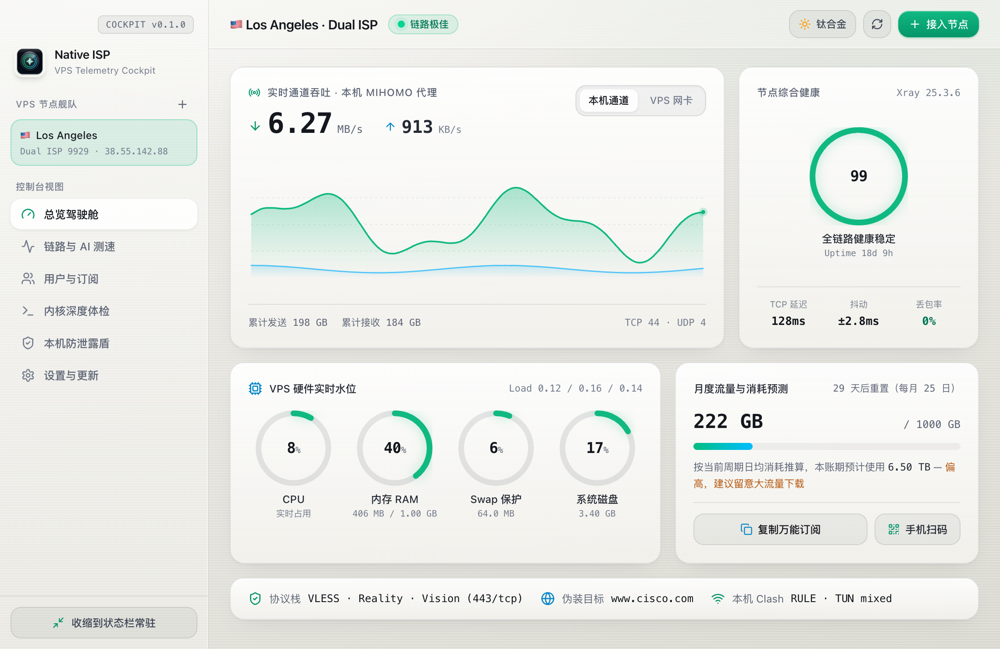
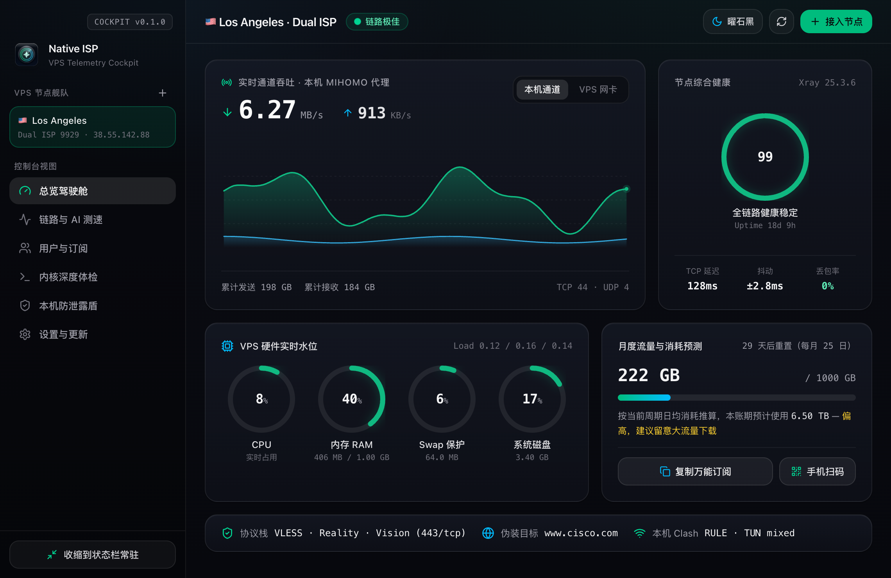
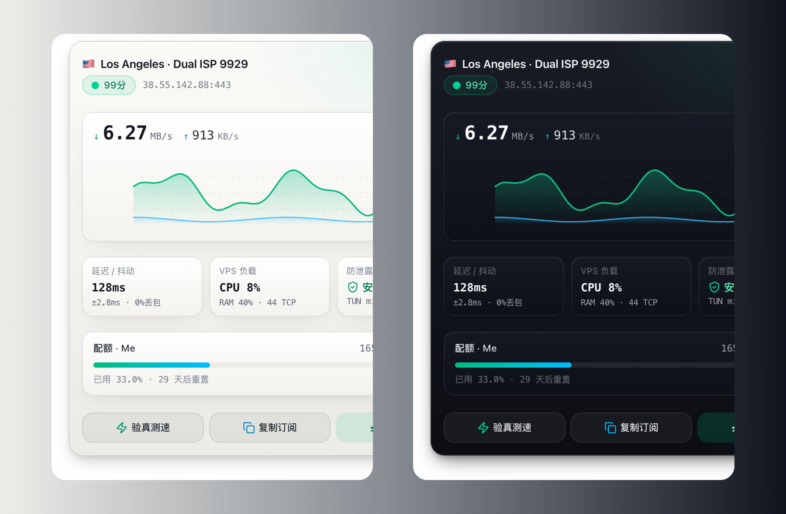
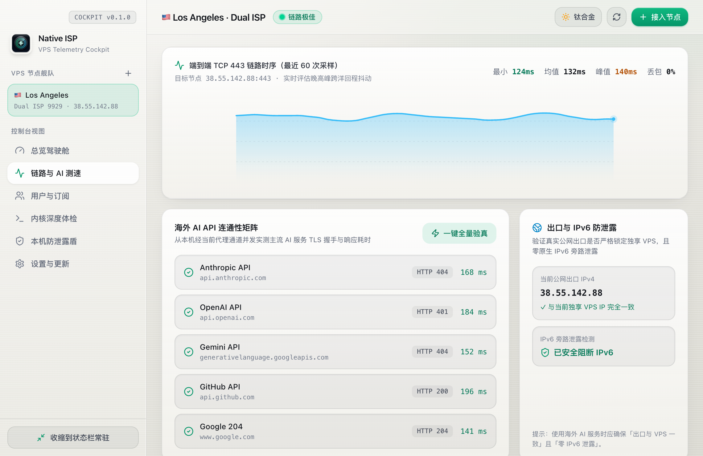
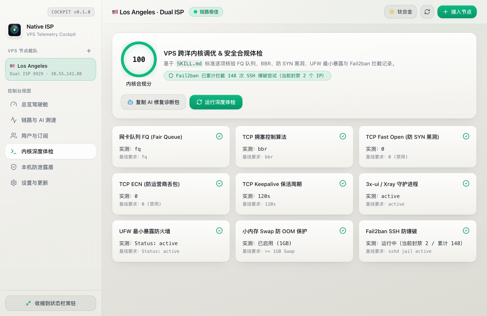
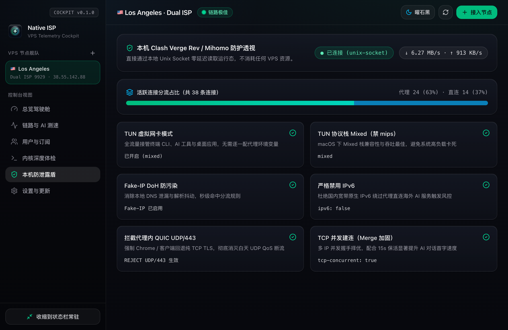

<div align="center">
  
  <h1>Native ISP VPS & Cockpit</h1>
  <p><strong>面向 AI 开发者的海外 VPS 全自动部署 Agent Skill + 原生桌面领航看板</strong></p>
  <p>
    <em>一句话让 AI 帮你完成 VPS 选型、跨洋 BBR/FQ 内核调优、纯 TCP Reality Vision 部署、本机 Clash Verge Rev 加固，并自动免密接入本地实时遥测看板。</em>
  </p>
  <p>
    
    
    
    
    
  </p>
</div>

<p align="center">
  
</p>

---

## 为什么做这个项目？

很多海外 VPS 教程只负责把节点「跑起来」，但日常高强度使用海外 AI 工具（Claude / ChatGPT / Gemini / Cursor / Antigravity）时，真正让人抓狂的是三件事：
1. **白天突然断流 / 晚高峰高抖动**：往往源于默认内核拥塞控制、UDP/QUIC 被 QoS、IPv6 泄露或僵尸 Socket 未淘汰。
2. **部署完就「盲飞」**：不知道剩余流量还有多少、不知道系统重启后 `BBR + FQ` 有没有掉回默认、分不清卡顿是本机 Wi-Fi 还是 VPS 拥堵。
3. **重型监控反噬小内存机**：在 512MB–1GB 的双 ISP VPS 上装 Prometheus/探针既吃内存又多暴露端口。

**Native ISP VPS & Cockpit** 把 **Day-0 全自动部署 Skill** 与 **Day-2 本地原生领航看板** 焊成一个零手工闭环：

```text
一句话发给 AI Agent ──▶ 执行 SKILL.md (Stage 1–5 内核调优 + 3x-ui + Clash 加固)
                                │
                                ▼ Stage 5.5（Zero-Touch 自动交接）
         一键安装/拉起本地看板 + 写入 0600 临时交接清单 + 配置专用 SSH 体检公钥
                                │
                                ▼（1 秒内加密写入系统 Keychain 并覆零粉碎临时文件）
      Native ISP Cockpit 实时掌控网速 / 延迟 / 配额 / AI 连通 / 防泄露
                                │
                                ▼ 检测到参数漂移或异常时
      一键复制「脱敏 AI 修复诊断包」──▶ 粘回给 AI 按 SKILL.md 秒级定点自愈
```

---

## 产品截图画廊

### 1. 双质感旗舰皮肤：原色钛合金（浅色） × 曜石黑（暗夜）
主窗口与顶部菜单栏浮窗实时联动，支持右上角一键切换。

| 原色钛合金 · Brushed Titanium | 曜石黑 · Obsidian Dark |
| :---: | :---: |
|  |  |

### 2. 双形态交互：随时收缩到状态栏常驻（零 Dock 占用）
点击关闭或「收缩到状态栏常驻」，macOS 自动隐藏 Dock 图标，菜单栏实时跳动 `↓网速 · 延迟`，左键呼出 `368×512` 毛玻璃微 HUD 浮窗。

<p align="center">
  
</p>

### 3. 链路时序、海外 AI 连通矩阵 & 零 IPv6 泄露验真
<p align="center">
  
</p>

### 4. VPS 内核合规 100/100 深度体检 & 本机 Clash 防泄露盾
| SSH 内核与安全合规体检（含 Fail2ban 拦截数 + AI 修复包） | 本机 Clash Verge Rev / Mihomo 防护透视 |
| :---: | :---: |
|  |  |

---

## 核心特性一览

### AI Agent Skill（[SKILL.md](./SKILL.md)）
- **极稳单一最优协议**：纯 TCP **VLESS + Reality + Vision (`443/tcp`)**，每条流独立 TCP 互不连坐、零白天 UDP QoS 断流、全端免脚本开箱即稳。
- **跨洋 TCP 内核 + Xray 双层调优**：热切网卡 `fq` + `BBR`、1GB 友好缓冲（`256KB` 默认 / `16MB` 上限）、显式禁用 `tcp_fastopen`/`tcp_ecn` 消除 SYN 黑洞、`120s` 内核保活 + Xray `sockopt`（`tcpUserTimeout=20000` 秒级淘汰僵尸连接）+ 内置双上游 IPv4 缓存 DNS。
- **全平台万能一条链 + 防泄露分流**：3x-ui 原生 UA 识别，一条订阅通吃 Clash Verge Rev / FlClash / Stash（YAML）与 Shadowrocket / v2rayNG（Base64）；内置**禁代理内 QUIC UDP/443**、全系海外 AI 域名强制代理、国内直连及剩余流量进度条。
- **Stage 5.5 看板一键接管**：AI 部署完 VPS 后自动安装/拉起本地看板、写入专用免密 SSH 体检公钥并完成 Zero-Touch 密钥链加密纳管。

### 本地领航看板（`app/` · Tauri v2 + Rust + React 19）
- **零额外 VPS 守护进程**：不向 1GB VPS 注入任何额外探针进程或新端口——复用 **3x-ui 原生 API**（Bearer Token 优先 + Cookie 登录兜底）与 **本机 Mihomo Unix Socket**，后台收起自动降频（`2s → 15s`）极度省资源。
- **系统钥匙串安全边界**：API Token 与面板密码仅加密写入 **macOS Keychain / Windows Credential Manager**，交接临时文件在 1 秒内覆零粉碎，绝不明文落盘、绝不进 Git。
- **多用户配额与手机扫码**：可视化展示 `Me` / `GF` 等成员配额与 30 天周期消耗预测，一键复制万能订阅或即时生成二维码供 iPhone Shadowrocket / Android FlClash 扫码导入。
- **GitHub Releases 自动热更新**：内置 `tauri-plugin-updater` 与自动化工作流（[.github/workflows/release-app.yml](./.github/workflows/release-app.yml)），推送新版本 Tag 后自动构建 macOS（Apple Silicon / Intel）与 Windows 签名包，客户端应用内一键静默更新重启。

---

## 快速上手（3 步）

### Step 1 · 安装 Agent Skill

```bash
git clone https://github.com/luvio-arlan/native-isp-vps.git
```

放到你使用的 AI 工具 Skills 目录：
- **Antigravity**：`~/.gemini/config/skills/native-isp-vps/`
- **Claude Code**：`~/.claude/skills/native-isp-vps/`
- **Cursor**：`<project>/.cursor/skills/native-isp-vps/`

### Step 2 · 一句话交给 AI 全自动部署并自动连上看板

直接把下面指令发给 AI（若还未买 VPS，AI 会先根据 [references/vps-guide.md](./references/vps-guide.md) 帮你选型）：

> 「用 `native-isp-vps` 帮我全自动部署这台海外 VPS，顺手加固本机 Clash Verge Rev，并一键安装且自动接入本地 Native ISP Cockpit 看板。」

### Step 3 · 手动运行或打包本地看板（可选）

> 前置环境：Node.js 22+、`pnpm`、Rust 工具链（`rustc` / `cargo`）。

```bash
cd app
pnpm install

# 开发模式预览（含状态栏 HUD + 双皮肤）
pnpm tauri dev

# 构建本机 macOS .app 与 .dmg 安装包
pnpm tauri build --bundles app,dmg
```

> 若你是仓库维护者，想开启推送 Tag 自动发版与客户端一键热更新，请按 [app/RELEASE.md](./app/RELEASE.md) 完成 3 步签名密钥配置。

---

## 仓库结构

```text
native-isp-vps/
├── SKILL.md                          # AI Agent 技能主文件（含 Stage 5.5 看板一键安装与自动交接）
├── README.md                         # 项目说明与产品截图画廊
├── LICENSE                           # MIT License
├── scripts/
│   └── cockpit-handoff.sh            # AI 部署完成后的 Zero-Touch 0600 安全交接脚本
├── docs/images/                      # 高清 2x Retina 产品实机截图与图标资源
├── references/
│   ├── vps-guide.md                  # 主流海外 VPS 客观选型速查
│   ├── sysctl-bbr-tuning.conf        # 1GB 友好跨洋 TCP 内核调优（FQ + BBR + 抗断流）
│   ├── mihomo-rules.yaml             # 禁 QUIC UDP/443 + 全系海外 AI 防泄露 + 国内直连规则
│   ├── clash-verge-dns.yaml          # Clash Verge Rev 防 IPv6/DNS 污染 Fake-IP 配置
│   └── clash-verge-merge.yaml        # Clash Verge Rev 订阅 Merge 配置（并发建连 + 15s 保活 + 嗅探）
├── app/                              # Native ISP Cockpit 本地领航看板（Tauri v2 + Rust + React）
│   ├── src/                          # Brushed Titanium & Obsidian 双皮肤前端 + 状态栏 HUD
│   ├── src-tauri/                    # Rust 遥测引擎、Keychain 密钥链、收件箱监听与自动更新
│   └── RELEASE.md                    # GitHub Releases 签名与客户端自动热更新配置说明
└── .github/workflows/
    └── release-app.yml               # GitHub Tag 自动构建 macOS/Windows 并发布 updater latest.json
```

---

## 免责声明

本项目仅提供标准 Linux 运维自动化、网络调优与本地可视化监控参考，请遵守当地法律法规及服务商条款。切勿将个人服务器 IP、SSH 密码、面板账密、签名私钥或订阅链接提交至任何公开仓库。
